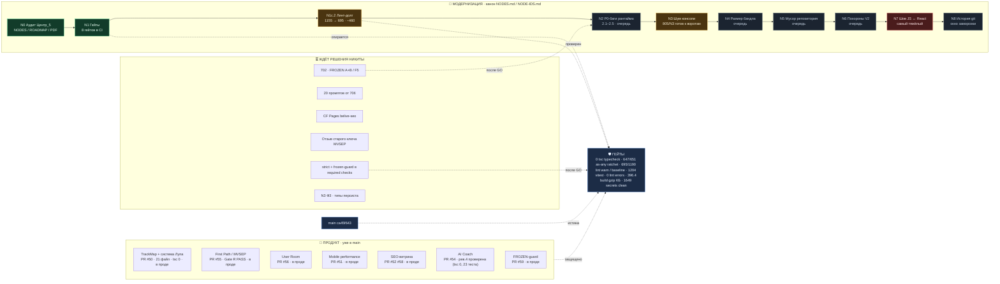

# beLive · Дорожная карта · ЕДИНЫЙ ГРАФ

> **Источник истины — `board/roadmap-data.json`.** Этот файл **генерируется**, руками не правится.
> GitHub рендерит Mermaid нативно в Markdown — без сборки и зависимостей.
> Граф виден владельцу, 707 и CEO в одном месте, рядом с кодом.
> **Снимок:** 09.11.2026 18:30 · `origin/main = ca45f643` · командование 707 до ~20:12.

<!-- GRAPH:START -->

<!-- GRAPH:END -->

## Как читать

- Магистраль `N0 → … → N8` — **модернизация** по `board/NODE-IDS.md`. Линт-долг = **N1c.2**, а не N2.
- Продуктовые линии идут **параллельно** и уже в проде; фундамент не отстаёт от фич.
- `OPEN` — решения Никиты. Без них узел не стартует; их не решают ни CEO, ни 707.
- **ПРОД-готовность** = магистраль до N6 включительно + пустой блок `OPEN`.
- **Осознанная граница, не долг:** FROZEN ~298 варнингов и `js/monitor-mix.js` 115. Центр_5 зафиксировал: «это не недоделка».
- **N7 / N8** — только после явного GO, отдельно. Шов JS↔React по объёму равен всем остальным узлам вместе, но не блокирует прод.

## Дрейф main за 09.11 (почему замеры переснимают)

`9c7c37b` → `f0717e1` (#54/#55) → `0464dd5` (#56) → `fd9a113` (#57/#58) → **`ca45f643`** (#59).

Правило №6: pregate только на текущем `origin/main`. Устаревшая база = FAIL.

## Конвейер «всегда актуально»

```
roadmap-data.json             ← ЕДИНСТВЕННЫЙ источник (правит командующий)
        │                       до мержа пакета: мост board/
        │                       после мержа:      репо docs/roadmap/
        ├─ generate-roadmap.mjs --write
        │     ├─→ ROADMAP.md          (Mermaid для GitHub)
        │     ├─→ ROADMAP-GRAPH.html (интерактивный пульт, без CDN)
        │     └─→ MIRROR_DIR         (вторая площадка, без ручного копирования)
        │
        └─ generate-roadmap.mjs --check   (CI, КАЖДЫЙ PR)
              ├─ exit 1 STALE      — забыли --write
              ├─ exit 3 INVALID    — опечатка в статусе / дубль id / битая схема
              └─ exit 0 in sync
```

🔴 **Почему Action НЕ коммитит в `main`:** ветка защищена (Require PR + статус-чеки). Автокоммит обошёл бы защиту. Поэтому CI **проверяет** актуальность, а обновляет граф командующий локально и сдаёт пакетом в 007_c.

## Ответы на три блокирующих вопроса (второй разбор DeepSeek)

**№1 · Триггер.** Workflow идёт на **все PR** (`on: pull_request` без `paths`), плюс push в `main`. Гейт на ~1 секунду (zero-dep, без `npm install`), так что «тратит минуты» неверно. `paths`-фильтр убран: PR со сменой статуса, не тронувший `docs/roadmap/`, теперь **не проходит молча**.

**№2 · Что сверяет `--check`.** Только **сгенерированные артефакты ↔ закоммиченные артефакты**. Поле `main` в JSON — **информационный снимок**, оно **не сравнивается с HEAD**: `main` двигается на каждом мерже, и такая проверка была бы вечно красной (ровно тот design-баг, о котором предупреждал DeepSeek). В CI передаётся `EXPECTED_MAIN` — он даёт **неблокирующий `⚠`** о возрасте снимка, а не fail.

**№3 · Мост ↔ репо.** Признаю: две копии = новый дрейф. Решение:
- **Канон после мержа = `docs/roadmap/roadmap-data.json` в репозитории.** Он виден и WorkBuddy (через `/mnt/c/...` или WSL-клон), и CEO в harness, и человеку на GitHub.
- Мостовая копия объявляется **зеркалом**, в неё пишет `MIRROR_DIR` при `--write`; `--check` проверяет обе площадки. Ручное копирование исчезает.
- Переход: пока пакет не влит, канон временно в мосту; 007_c кладёт файлы в репо → с этого момента правится только репо-клон. Зафиксировано в MANIFEST.

**№4 · HTML без CDN.** В HTML **нет Mermaid-рендера вообще**. Это свой минимальный рендерер на `div` + CSS + ~60 строк JS, который читает встроенный `DATA`. Ни встроенной библиотеки на 2–3 МБ, ни предрендера в SVG. Значит «live» честно означает: **живой дашборд из одного JSON**, а не «живой Mermaid». GitHub показывает Mermaid из `ROADMAP.md` (статично), пульт даёт клики/детали (интерактивно). Разные представления — один источник.

**№5 · Валидация.** Добавлена: `schema`, enum `cls ∈ {done, active, queued, risk}`, `p ∈ [0..100]`, уникальность `id`, обязательные поля. Опечатка `in progres` теперь падает **громко** (`✗ INVALID DATA`, `exit 3`), а не молча рисует серый узел.

**№6 · Дисциплина.** Записана в `rules/PLAYBOOK.md` → **Definition of Done**: любой PR, меняющий статус/метрику/состав, обязан включать перегенерированный roadmap. Без `--write` + `--check` пакет не готов.

## Протокол синхронизации

1. Перед обновлением: `git ls-remote origin main`; SHA в `roadmap-data.json` — снимок, не гейт.
2. **Один владелец:** JSON правит **только командующий** (707 / CEO). Агенты присылают отчёты файлом.
3. **Триггер:** влился PR · сменился статус узла · изменились гейты · появилось/снялось решение Никиты.
4. **DoD:** `BOARD.md` (летопись) → JSON → `--write` → `--check` → пре-gate → 007_c. Генерируемые блоки руками не правим.
5. **Расхождение в цифрах** закрывается разбивкой по зонам, не спором. В данные попадает только проверенное.
6. Возврат состояния CEO_Orch через 5 часов сверяется с этими данными; разошлись — правится сначала источник.

## Инструменты (проверено 09.11, в т.ч. независимой проверкой DeepSeek)

| Решение | Вердикт |
|---|---|
| **Mermaid** | ✅ слой отображения для GitHub. Нативный рендер, diagram-as-code, приватно |
| **`roadmap-data.json` + генератор** | ✅ источник истины. Заменяет «живой» инструмент без внешних зависимостей |
| **ROADMAP-GRAPH.html** | ✅ локальный интерактивный пульт: статусы, клики, блокеры. Без Node и CDN |
| **Plangy** (`npm 0.6.12`) | ⚠️ реален, «plan.md → live-reload в браузере». Держать в резерве, если захотим готовый live-reload |
| **GitDiagram** | ⚠️ другой класс: архитектура кода, не roadmap. Совместим как второй слой (отдаёт Mermaid) |
| **D2 / LikeC4 / Structurizr / Roadmapper** | ⚠️ реальны, но требуют бинаря/CI/DSL и не рендерятся в GitHub нативно |
| **Nodit / planpilot** | ❌ **не существуют** (npm 404, GitHub 0 репо) — в ответе DeepSeek были галлюцинации. Не внедрять |

Ссылки и разбор — `board/GRAPH-RESEARCH-VERDICT.md`.

## Поддержка

- Данные: `board/BOARD.md`, `board/NODE-IDS.md`, `board/REGISTRY.md`, `opencode-import/centr-5/NODES.md`.
- Если скопировать `ROADMAP.md` в репозиторий, GitHub отрендерит граф сам.
- Обновляет файл — командующий (707 / CEO) после каждой смены `origin/main`.
